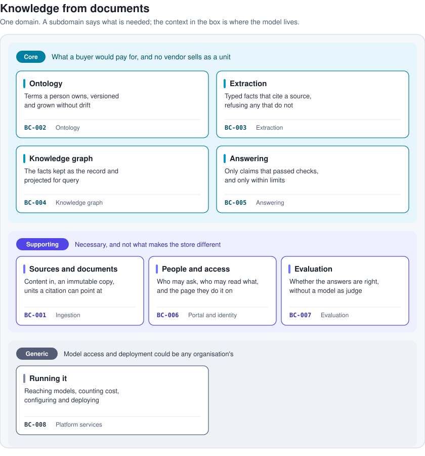

# The domain and its subdomains

The domain is knowledge from documents: taking what an organisation has written and making it answerable, with every answer traceable to what was written. The subdomains are the demand space the bounded contexts map to; a subdomain says what is needed, a context says where the model that meets it lives.

| Subdomain | What is needed | Kind | Maps to |
|---|---|---|---|
| Sources and documents | Getting content in, keeping an immutable copy, and cutting it into the units a citation points at | supporting | BC-001 Ingestion |
| Ontology | Saying what the documents are about, in terms a person owns, versioned and grown without drift | core | BC-002 Ontology |
| Extraction | Turning passages and table rows into typed facts that cite where they came from, and refusing facts that do not | core | BC-003 Extraction |
| Knowledge graph | Keeping the facts as the record, projecting them for query, and answering fixed questions in the ontology's terms | core | BC-004 Knowledge graph |
| Answering | Taking a person's question to an answer made only of claims that passed their checks, within limits | core | BC-005 Answering |
| People and access | Who may ask, who may read what, and the page they do it on | supporting | BC-006 Portal and identity |
| Evaluation | Knowing whether the answers are right, without a model as judge | supporting | BC-007 Evaluation |
| Running it | Reaching models, counting cost, configuring and deploying | generic | BC-008 Platform services |

The core subdomains are the ones a buyer would pay for and no vendor sells as a unit: the ontology lifecycle, extraction with provenance, the graph as record, and grounded answering. Ingestion, identity and evaluation are supporting: necessary, built here, but not what makes the store different. Platform services are generic: model access and deployment could be any organisation's.

Two things the subdomains make visible. The ontology is a subdomain of its own rather than part of extraction, because its lifecycle (discover, review, curate, publish, classify, grow) has its own language and its own owner, the curator, and outlives any one extraction. And answering is separate from the graph, because the same graph can be read by a different front (a person's own assistant over MCP) and the same answering rules apply to table facts and passage facts alike.
