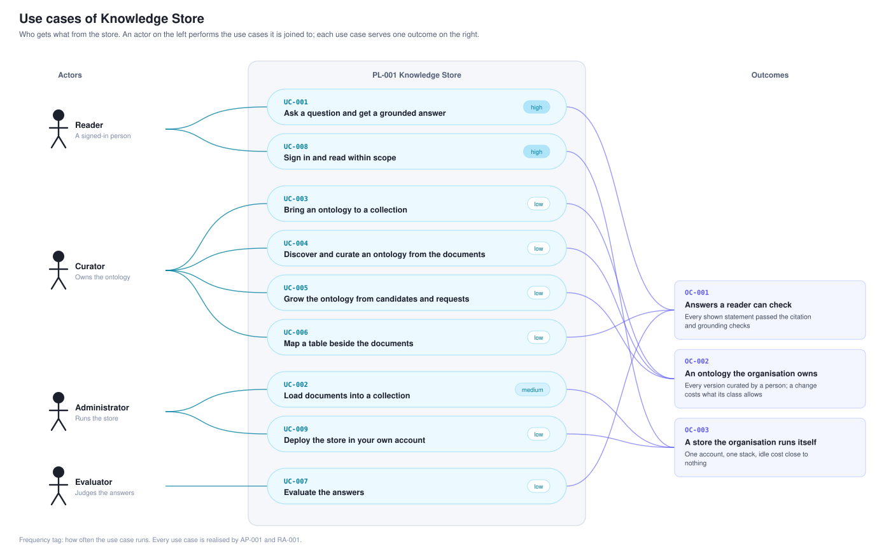

# Use cases

What an actor gets from the store, written in the use-case skill's form: participants, interactions and scenarios in the same model form a pattern uses, so the pattern that realises each can be checked against it. Every one is realised by AP-001 (logical) and RA-001 (physical) and fulfilled by the features in [../features.csv](../features.csv). The register is [../use-cases.csv](../use-cases.csv).

| Use case | Actor | Outcome |
|---|---|---|
| [UC-001 Ask a question and get a grounded answer](UC-001-ask-a-question-and-get-a-grounded-answer/index.md) | A reader (a signed-in person) | OC-001 |
| [UC-002 Load documents into a collection](UC-002-load-documents-into-a-collection/index.md) | An administrator | OC-003 |
| [UC-003 Bring an ontology to a collection](UC-003-bring-an-ontology-to-a-collection/index.md) | A curator | OC-002 |
| [UC-004 Discover and curate an ontology from the documents](UC-004-discover-and-curate-an-ontology-from-the-documents/index.md) | A curator | OC-002 |
| [UC-005 Grow the ontology from candidates and requests](UC-005-grow-the-ontology-from-candidates-and-requests/index.md) | A curator | OC-002 |
| [UC-006 Map a table beside the documents](UC-006-map-a-table-beside-the-documents/index.md) | A curator | OC-001 |
| [UC-007 Evaluate the answers](UC-007-evaluate-the-answers/index.md) | An evaluator | OC-001 |
| [UC-008 Sign in and read within scope](UC-008-sign-in-and-read-within-scope/index.md) | A reader | OC-003 |
| [UC-009 Deploy the store in your own account](UC-009-deploy-the-store-in-your-own-account/index.md) | An administrator | OC-003 |

A consuming application's own use cases are the demand side of the same store seen from that application; they cite these as `ks:UC-NNN` where they overlap.
