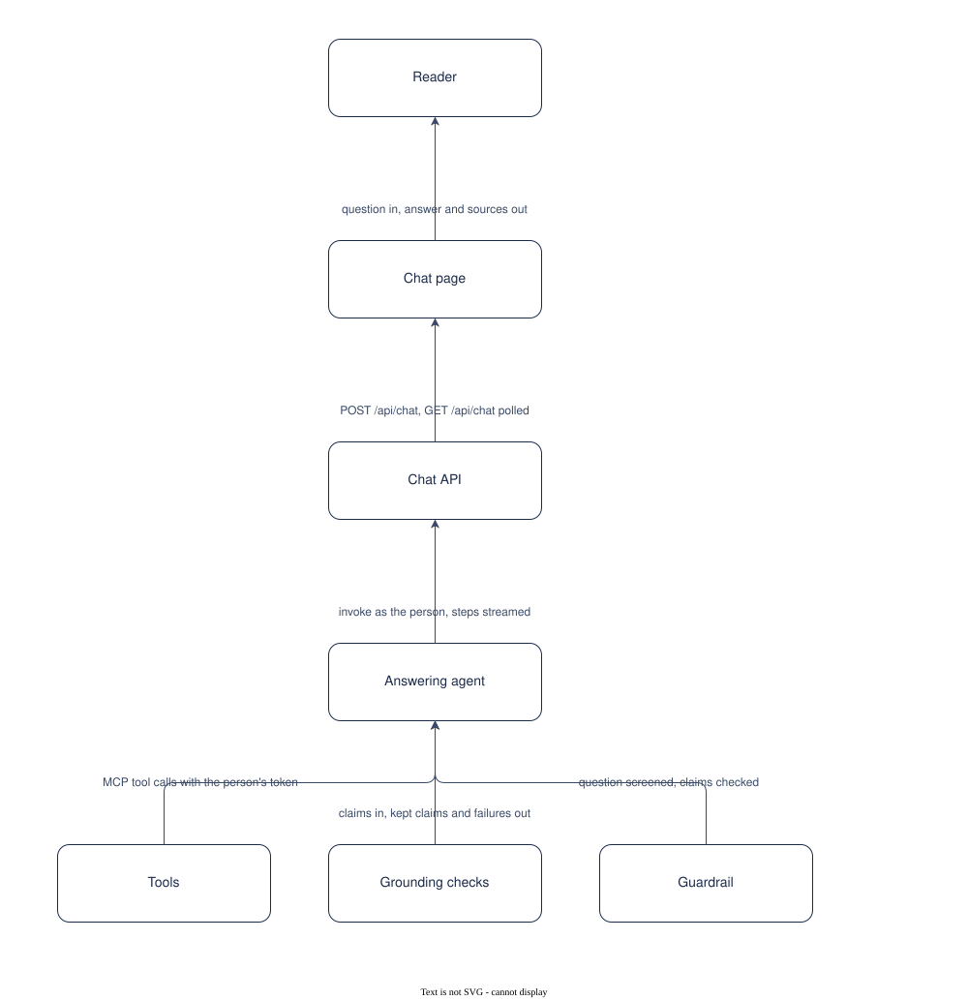

# UC-001 Ask a question and get a grounded answer

<!-- deck:cover subtitle="Ask a question and get a grounded answer" footnote="Use case, reversed from the implementation at 0.3.0. Draft." -->

| Field | Value |
|---|---|
| Use case | UC-001 |
| Consumer | A reader (a signed-in person) |
| Owner | Patternode (Dermot O'Brien) |
| Outcome | OC-001 |
| Rests on | The implementation as released; this use case is reversed from it |
| Realised by | PAT-001 Ontology-driven GraphRAG (logical) and REF-001 Knowledge Store on AWS (physical) |
| Fulfilled by | FE-001, FE-002, FE-008, FE-009, FE-010 |
| Date | 2026-10-16 |

<!-- deck:slide label="In one sentence" -->

## The solution in one sentence

A reader asks a question of a collection in plain language and gets an answer made only of statements that link to the passage or the table cell they came from, so that every sentence can be checked by opening its source.

Documents answer questions slowly and a model answers them fluently but unverifiably. The reader needs the speed of the second with the authority of the first.

### What is different afterwards

The reader clicks a numbered citation and sees the quoted words highlighted in the passage, or the row of the table with the cell highlighted. When the sources cannot answer, the reader is told so and what was missing, and can ask what it would take.

<!-- deck:slide label="On one page" title="The solution on one page" -->

## Diagram

Generated from the Participants and Interactions tables with the model skill; `components.drawio` is the source.

<!-- deck:slide label="Participants" -->

## Participants

| Participant | Role in this use case | Kind |
|---|---|---|
| 01 Reader | Asks, reads, checks | actor |
| 02 Chat page | Takes the question, shows claims, sources, steps | solution |
| 03 Chat API | Checks quota, dispatches, keeps the answer | solution |
| 04 Answering agent | Plans in the ontology's terms, calls tools, proposes claims | solution |
| 05 Tools | Fixed queries over the graph, tables and passages, as the caller | solution |
| 06 Grounding checks | Re-reads every citation and keeps what passes | solution |
| 07 Guardrail | Screens the question; checks each claim's grounding | external |

<!-- deck:slide label="Interactions" -->

## Interactions

| Interface | Provider | Consumer | Purpose |
|---|---|---|---|
| IF-01 | 02 Chat page | 01 Reader | question in, answer and sources out |
| IF-02 | 03 Chat API | 02 Chat page | POST /api/chat, GET /api/chat polled |
| IF-03 | 04 Answering agent | 03 Chat API | invoke as the person, steps streamed |
| IF-04 | 05 Tools | 04 Answering agent | MCP tool calls with the person's token |
| IF-05 | 06 Grounding checks | 04 Answering agent | claims in, kept claims and failures out |
| IF-06 | 07 Guardrail | 04 Answering agent | question screened, claims checked |

<!-- deck:slide label="Catalogue mapping" -->

## Catalogue Mapping

What each local participant stands for in the catalogue: an actor or an external system is a gap by design (no artefact of this catalogue realises a person or a vendor); a solution participant realises or partly realises a building block.

| Local ID | Maps To | Relationship |
|---|---|---|
| 01 | gap | gap |
| 02 | ABB-018 Chat page | realises |
| 03 | ABB-019 Chat API | realises |
| 04 | ABB-014 Answering agent | realises |
| 05 | ABB-012 Tool gateway and fixed query tools | partial |
| 06 | ABB-014 Answering agent | partial |
| 07 | gap | gap |

## Scenarios

Step through the flows in the [animated walkthrough](./scenarios.html).

<!-- deck:html src="./scenarios.html" title="The flow" header="true" -->

### S1 Main success scenario

| Step | Actor | Target | Action | Interface |
|---|---|---|---|---|
| 1 | 01 Reader | 02 Chat page | type a question and choose the collection | IF-01 |
| 2 | 02 Chat page | 03 Chat API | post the question with the last six turns | IF-02 |
| 3 | 03 Chat API | 04 Answering agent | take the daily quota, invoke the agent as the person | IF-03 |
| 4 | 04 Answering agent | 07 Guardrail | screen the question | IF-06 |
| 5 | 04 Answering agent | 05 Tools | read the ontology rendition and the tables; search entities and passages | IF-04 |
| 6 | 04 Answering agent | 06 Grounding checks | propose claims with citations | IF-05 |
| 7 | 06 Grounding checks | 05 Tools | re-read every cited passage, cell and figure as the person | IF-04 |
| 8 | 06 Grounding checks | 04 Answering agent | return the kept claims; send failures back once for repair | IF-05 |
| 9 | 04 Answering agent | 07 Guardrail | check each kept claim against its sources | IF-06 |
| 10 | 04 Answering agent | 03 Chat API | return the rendered answer, sources, steps and cost | IF-03 |
| 11 | 02 Chat page | 01 Reader | show the answer with numbered citations and the workbench | IF-01 |

### S2 The sources cannot answer

| Step | Actor | Target | Action | Interface |
|---|---|---|---|---|
| 1 | 04 Answering agent | 06 Grounding checks | propose claims; none survives, or the answer is marked unanswerable | IF-05 |
| 2 | 04 Answering agent | 03 Chat API | return an abstention naming what was missing | IF-03 |
| 3 | 02 Chat page | 01 Reader | show the abstention and offer "What would it take?" | IF-01 |

### S3 A table answers it

| Step | Actor | Target | Action | Interface |
|---|---|---|---|---|
| 1 | 04 Answering agent | 05 Tools | describe the mapped tables; look up rows or aggregate | IF-04 |
| 2 | 04 Answering agent | 06 Grounding checks | cite a cell with its value, or a figure with its computation | IF-05 |
| 3 | 06 Grounding checks | 05 Tools | recompute the figure from the snapshot | IF-04 |
| 4 | 02 Chat page | 01 Reader | show the row with the cell highlighted | IF-01 |

<!-- deck:slide label="Data and measures" title="Data and measures" -->

## Data

- The question, the history, the collection id
- The claims with citations, the sources, the steps, the usage and cost
- Term usage counters per collection, all time and per month

## Measures

- OC-001-M1 shown claims that passed, 100 percent
- Time to first step and to the answer
- Questions abstained, by collection

## Preconditions and success

Preconditions: The collection has an active ontology version and a built index; The person is signed in and within their daily quota.

Success: Every shown claim cites a passage with a quote found in it, or a cell or figure that recomputes from the snapshot; A question the sources cannot answer gets a stated abstention, not a guess; The steps and the cost of the answer are visible while it runs.
