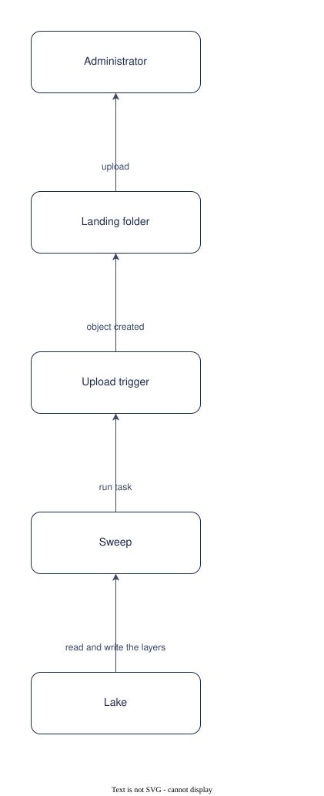

# UC-002 Load documents into a collection

<!-- deck:cover subtitle="Load documents into a collection" footnote="Use case, reversed from the implementation at 0.3.0. Draft." -->

| Field | Value |
|---|---|
| Use case | UC-002 |
| Consumer | An administrator |
| Owner | Patternode (Dermot O'Brien) |
| Outcome | OC-003 |
| Rests on | The implementation as released; this use case is reversed from it |
| Realised by | PAT-001 Ontology-driven GraphRAG (logical) and REF-001 Knowledge Store on AWS (physical) |
| Fulfilled by | FE-022, FE-017 |
| Date | 2026-10-16 |

<!-- deck:slide label="In one sentence" -->

## The solution in one sentence

An administrator puts documents into a collection's landing folder, or points the collection at a source, and the next sweep ingests, refines, extracts and projects them without anyone running a step, so that the store stays current with what is written.

A store that needs an operator to run a pipeline falls behind the documents. The sweep has to be something uploads start and a schedule backs up.

### What is different afterwards

Upload and wait. The status page shows the stage; the chat answers from the new documents at the next sweep.

<!-- deck:slide label="On one page" title="The solution on one page" -->

## Diagram

Generated from the Participants and Interactions tables with the model skill; `components.drawio` is the source.

<!-- deck:slide label="Participants" -->

## Participants

| Participant | Role in this use case | Kind |
|---|---|---|
| 01 Administrator | Uploads or configures a source | actor |
| 02 Landing folder | The upload location in the lake | solution |
| 03 Upload trigger | Object created event to the queue to the task | solution |
| 04 Sweep | Ingest, refine, discover or publish, extract, bind, project, load | solution |
| 05 Lake | Bronze, silver, gold and the ontology | solution |

<!-- deck:slide label="Interactions" -->

## Interactions

| Interface | Provider | Consumer | Purpose |
|---|---|---|---|
| IF-01 | 02 Landing folder | 01 Administrator | upload |
| IF-02 | 03 Upload trigger | 02 Landing folder | object created |
| IF-03 | 04 Sweep | 03 Upload trigger | run task |
| IF-04 | 05 Lake | 04 Sweep | read and write the layers |

<!-- deck:slide label="Catalogue mapping" -->

## Catalogue Mapping

What each local participant stands for in the catalogue: an actor or an external system is a gap by design (no artefact of this catalogue realises a person or a vendor); a solution participant realises or partly realises a building block.

| Local ID | Maps To | Relationship |
|---|---|---|
| 01 | gap | gap |
| 02 | ABB-002 Lake | partial |
| 03 | gap | gap |
| 04 | ABB-024 Ingestion and extraction pipeline | realises |
| 05 | ABB-002 Lake | realises |

## Scenarios

Step through the flows in the [animated walkthrough](./scenarios.html).

<!-- deck:html src="./scenarios.html" title="The flow" header="true" -->

### S1 Main success scenario

| Step | Actor | Target | Action | Interface |
|---|---|---|---|---|
| 1 | 01 Administrator | 02 Landing folder | upload files under landing/<collection>/ | IF-01 |
| 2 | 02 Landing folder | 03 Upload trigger | emit object created | IF-02 |
| 3 | 03 Upload trigger | 04 Sweep | start one task; a lock makes sure only one sweeps | IF-03 |
| 4 | 04 Sweep | 05 Lake | ingest to bronze by content hash; refine to silver passages | IF-04 |
| 5 | 04 Sweep | 05 Lake | extract against the active version; bind mapped tables; project; load the graph, the backends and the passage index | IF-04 |
| 6 | 04 Sweep | 05 Lake | write portal/status.json ready | IF-04 |

### S2 No ontology yet

| Step | Actor | Target | Action | Interface |
|---|---|---|---|---|
| 1 | 04 Sweep | 05 Lake | refine; with enough documents, discover a draft and stop at awaiting curation | IF-04 |

<!-- deck:slide label="Data and measures" title="Data and measures" -->

## Data

- Source configuration, scope per source
- Bronze meta per file: document id, source keys, scope, content type
- Status per collection

## Measures

- Time from upload to ready
- Files skipped as unchanged
- Sweeps that failed, by stage

## Preconditions and success

Preconditions: The deployment is applied and the collection is configured with its sources; The person may write to the landing prefix.

Success: Every distinct file has one bronze copy with every source key that named it; Unchanged files cost nothing on the next sweep; A mapped table is bound, not refined.
