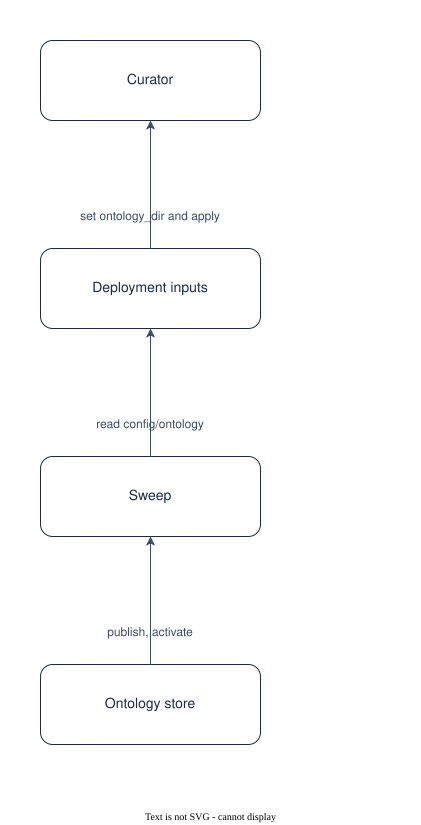

# UC-003 Bring an ontology to a collection

<!-- deck:cover subtitle="Bring an ontology to a collection" footnote="Use case, reversed from the implementation at 0.3.0. Draft." -->

| Field | Value |
|---|---|
| Use case | UC-003 |
| Consumer | A curator |
| Owner | Patternode (Dermot O'Brien) |
| Outcome | OC-002 |
| Rests on | The implementation as released; this use case is reversed from it |
| Realised by | PAT-001 Ontology-driven GraphRAG (logical) and REF-001 Knowledge Store on AWS (physical) |
| Fulfilled by | FE-003, FE-005 |
| Date | 2026-10-16 |

<!-- deck:slide label="In one sentence" -->

## The solution in one sentence

A curator gives a collection an ontology they already have, as a Turtle master beside optional shapes, a table mapping and metrics, and the store publishes and extracts against it, so that the graph is typed in the organisation's own terms from the first document.

An organisation with a standard's ontology, or one of its own, should not have one discovered for it. Bringing an ontology must be configuration, and changing it must be a version.

### What is different afterwards

The collection's ontology_dir names the files; apply uploads them; the sweep publishes the version owl:versionInfo names and activates it. To change it, bump the version and apply.

<!-- deck:slide label="On one page" title="The solution on one page" -->

## Diagram

Generated from the Participants and Interactions tables with the model skill; `components.drawio` is the source.

<!-- deck:slide label="Participants" -->

## Participants

| Participant | Role in this use case | Kind |
|---|---|---|
| 01 Curator | Owns the master and its versions | actor |
| 02 Deployment inputs | ontology_dir on the collection | solution |
| 03 Sweep | Publishes and activates the provided version | solution |
| 04 Ontology store | Versions, renditions, manifests, the active pointer | solution |

<!-- deck:slide label="Interactions" -->

## Interactions

| Interface | Provider | Consumer | Purpose |
|---|---|---|---|
| IF-01 | 02 Deployment inputs | 01 Curator | set ontology_dir and apply |
| IF-02 | 03 Sweep | 02 Deployment inputs | read config/ontology |
| IF-03 | 04 Ontology store | 03 Sweep | publish, activate |

<!-- deck:slide label="Catalogue mapping" -->

## Catalogue Mapping

What each local participant stands for in the catalogue: an actor or an external system is a gap by design (no artefact of this catalogue realises a person or a vendor); a solution participant realises or partly realises a building block.

| Local ID | Maps To | Relationship |
|---|---|---|
| 01 | gap | gap |
| 02 | ABB-002 Lake | partial |
| 03 | ABB-024 Ingestion and extraction pipeline | realises |
| 04 | ABB-002 Lake | partial |

## Scenarios

Step through the flows in the [animated walkthrough](./scenarios.html).

<!-- deck:html src="./scenarios.html" title="The flow" header="true" -->

### S1 Main success scenario

| Step | Actor | Target | Action | Interface |
|---|---|---|---|---|
| 1 | 01 Curator | 02 Deployment inputs | point ontology_dir at ontology.ttl, shapes.ttl, mappings.yaml, metrics.osi.yaml; apply | IF-01 |
| 2 | 03 Sweep | 02 Deployment inputs | find a provided ontology newer than the active version | IF-02 |
| 3 | 03 Sweep | 04 Ontology store | publish the version, render every rendition, write the manifest, activate | IF-03 |
| 4 | 03 Sweep | 04 Ontology store | extract every document against it | IF-03 |

### S2 A change without a bump

| Step | Actor | Target | Action | Interface |
|---|---|---|---|---|
| 1 | 03 Sweep | 02 Deployment inputs | find a changed file under the same version | IF-02 |
| 2 | 03 Sweep | 04 Ontology store | refuse; write the reason to the status | IF-03 |

<!-- deck:slide label="Data and measures" title="Data and measures" -->

## Data

- The master, shapes, mapping and metrics
- The manifest with checksums and the change kind

## Measures

- OC-002-M1 versions curated by a person

## Preconditions and success

Preconditions: The master parses as OWL Turtle with at least one class and a semver owl:versionInfo; A mapping, if present, names only terms the ontology has.

Success: The version is published, immutable, with its renditions and manifest; A changed file without a version bump is refused and reported in the status; Discovery never runs for this collection.
