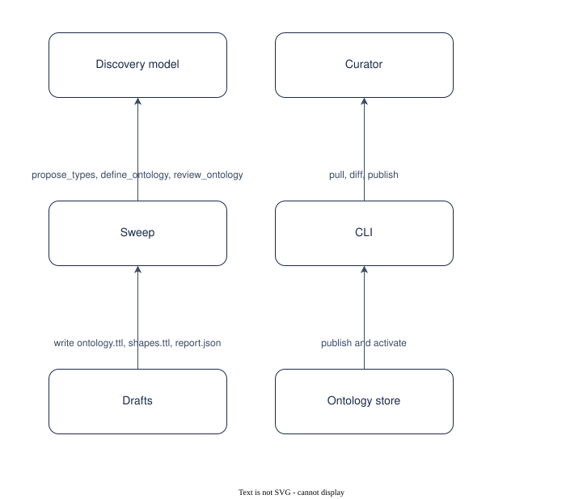

# UC-004 Discover and curate an ontology from the documents

<!-- deck:cover subtitle="Discover and curate an ontology from the documents" footnote="Use case, reversed from the implementation at 0.3.0. Draft." -->

| Field | Value |
|---|---|
| Use case | UC-004 |
| Consumer | A curator |
| Owner | Patternode (Dermot O'Brien) |
| Outcome | OC-002 |
| Rests on | The implementation as released; this use case is reversed from it |
| Realised by | PAT-001 Ontology-driven GraphRAG (logical) and REF-001 Knowledge Store on AWS (physical) |
| Fulfilled by | FE-004, FE-005 |
| Date | 2026-10-16 |

<!-- deck:slide label="In one sentence" -->

## The solution in one sentence

A curator lets the store propose a first ontology from a sample of the documents, reviews the draft in git, and publishes it as a version, so that a collection with no ontology gets one a person has read and approved.

Writing an ontology from nothing is slow; taking one a model wrote unread is unsafe. The draft has to carry its evidence and the curator has to be the one who publishes.

### What is different afterwards

A draft with each term's document support and the review's applied and skipped edits; the curator pulls, edits, diffs and publishes 0.1.0, or in auto mode the sweep publishes it provisionally.

<!-- deck:slide label="On one page" title="The solution on one page" -->

## Diagram

Generated from the Participants and Interactions tables with the model skill; `components.drawio` is the source.

<!-- deck:slide label="Participants" -->

## Participants

| Participant | Role in this use case | Kind |
|---|---|---|
| 01 Curator | Reads, edits, publishes | actor |
| 02 Sweep | Samples, proposes, consolidates, reviews, writes the draft | solution |
| 03 Discovery model | Proposes and reviews terms | external |
| 04 Drafts | ontology/drafts/<id> | solution |
| 05 CLI | pull, diff, publish, activate | solution |
| 06 Ontology store | Versions and the active pointer | solution |

<!-- deck:slide label="Interactions" -->

## Interactions

| Interface | Provider | Consumer | Purpose |
|---|---|---|---|
| IF-01 | 02 Sweep | 03 Discovery model | propose_types, define_ontology, review_ontology |
| IF-02 | 04 Drafts | 02 Sweep | write ontology.ttl, shapes.ttl, report.json |
| IF-03 | 05 CLI | 01 Curator | pull, diff, publish |
| IF-04 | 06 Ontology store | 05 CLI | publish and activate |

<!-- deck:slide label="Catalogue mapping" -->

## Catalogue Mapping

What each local participant stands for in the catalogue: an actor or an external system is a gap by design (no artefact of this catalogue realises a person or a vendor); a solution participant realises or partly realises a building block.

| Local ID | Maps To | Relationship |
|---|---|---|
| 01 | gap | gap |
| 02 | ABB-004 Pipeline sweep | realises |
| 03 | gap | gap |
| 04 | ABB-002 Lake and layering | partial |
| 05 | ABB-006 Ontology publisher | realises |
| 06 | ABB-002 Lake and layering | partial |

## Scenarios

Step through the flows in the [animated walkthrough](./scenarios.html).

<!-- deck:html src="./scenarios.html" title="The flow" header="true" -->

### S1 Main success scenario

| Step | Actor | Target | Action | Interface |
|---|---|---|---|---|
| 1 | 02 Sweep | 03 Discovery model | propose classes, relations and attributes per sampled document, with grounded examples | IF-01 |
| 2 | 02 Sweep | 03 Discovery model | consolidate to about fifteen classes with a hierarchy, domains, ranges and datatypes | IF-01 |
| 3 | 02 Sweep | 03 Discovery model | review: parents, merges, drops, corrections, each with a reason | IF-01 |
| 4 | 02 Sweep | 04 Drafts | write the draft and its report; stop at awaiting curation | IF-02 |
| 5 | 01 Curator | 05 CLI | pull the draft, edit the Turtle, diff against nothing | IF-03 |
| 6 | 05 CLI | 06 Ontology store | publish 0.1.0 with --activate | IF-04 |

### S2 Auto mode

| Step | Actor | Target | Action | Interface |
|---|---|---|---|---|
| 1 | 02 Sweep | 06 Ontology store | publish the draft as 0.1.0, noted provisional, and continue to extraction | IF-04 |

<!-- deck:slide label="Data and measures" title="Data and measures" -->

## Data

- The sample, the proposals with support and stability, the consolidated draft, the review edits

## Measures

- Terms in the draft with two or more supporting documents
- Review edits skipped, by reason

## Preconditions and success

Preconditions: At least the minimum number of refined documents; No active version and no draft, or auto mode.

Success: Every example in the draft is verbatim in the passage it cites; The review's edits are listed and reversible; Publish refuses a version that understates the change.
