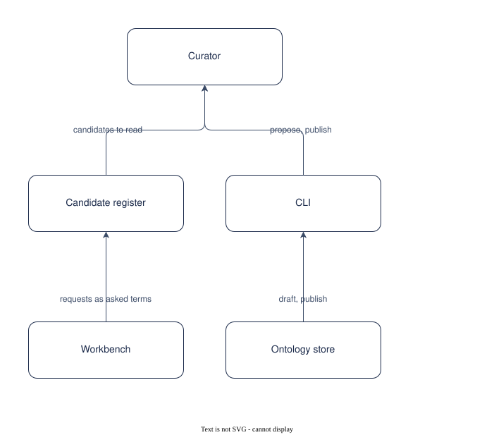

# UC-005 Grow the ontology from candidates and requests

<!-- deck:cover subtitle="Grow the ontology from candidates and requests" footnote="Use case, reversed from the implementation at 0.3.0. Draft." -->

| Field | Value |
|---|---|
| Use case | UC-005 |
| Consumer | A curator |
| Owner | Patternode (Dermot O'Brien) |
| Outcome | OC-002 |
| Rests on | The implementation as released; this use case is reversed from it |
| Realised by | AP-001 Ontology-driven GraphRAG (logical) and RA-001 Knowledge Store on AWS (physical) |
| Fulfilled by | FE-006, FE-010 |
| Date | 2026-10-16 |

<!-- deck:slide label="In one sentence" -->

## The solution in one sentence

A curator takes the terms extraction could not place and the ontology requests kept from the workbench, and publishes them as the next minor version, so that the ontology grows from demand without a term entering it unread.

An ontology that cannot grow is abandoned; one that grows by itself drifts. Growth has to come from evidence (documents that named a term, questions that needed one) and pass through a person.

### What is different afterwards

candidates --propose writes a revision draft one minor version up; the curator reviews and publishes; the next sweep runs a delta extraction of the new terms only.

<!-- deck:slide label="On one page" title="The solution on one page" -->

## Diagram

Generated from the Participants and Interactions tables with the model skill; `components.drawio` is the source.

<!-- deck:slide label="Participants" -->

## Participants

| Participant | Role in this use case | Kind |
|---|---|---|
| 01 Curator | Decides what the next version holds | actor |
| 02 Candidate register | Terms with their documents, evidence and nearest existing term | solution |
| 03 Workbench | Gap reports kept as ontology requests | solution |
| 04 CLI | candidates --propose; publish | solution |
| 05 Ontology store | Drafts and versions | solution |

<!-- deck:slide label="Interactions" -->

## Interactions

| Interface | Provider | Consumer | Purpose |
|---|---|---|---|
| IF-01 | 02 Candidate register | 01 Curator | candidates to read |
| IF-02 | 03 Workbench | 02 Candidate register | requests as asked terms |
| IF-03 | 04 CLI | 01 Curator | propose, publish |
| IF-04 | 05 Ontology store | 04 CLI | draft, publish |

<!-- deck:slide label="Catalogue mapping" -->

## Catalogue Mapping

What each local participant stands for in the catalogue: an actor or an external system is a gap by design (no artefact of this catalogue realises a person or a vendor); a solution participant realises or partly realises a building block.

| Local ID | Maps To | Relationship |
|---|---|---|
| 01 | gap | gap |
| 02 | ABB-002 Lake | partial |
| 03 | ABB-014 Answering agent | partial |
| 04 | ABB-028 Command line | realises |
| 05 | ABB-002 Lake | partial |

## Scenarios

Step through the flows in the [animated walkthrough](./scenarios.html).

<!-- deck:html src="./scenarios.html" title="The flow" header="true" -->

### S1 Main success scenario

| Step | Actor | Target | Action | Interface |
|---|---|---|---|---|
| 1 | 01 Curator | 03 Workbench | keep a "what would it take" report as an ontology request | IF-02 |
| 2 | 01 Curator | 04 CLI | run candidates --propose | IF-03 |
| 3 | 04 CLI | 02 Candidate register | keep terms with enough documents or a request, not covered by a synonym | IF-01 |
| 4 | 04 CLI | 05 Ontology store | consolidate with the current ontology held fixed; write the draft at the next minor version | IF-04 |
| 5 | 01 Curator | 04 CLI | pull, edit, diff; publish and activate | IF-03 |
| 6 | 05 Ontology store | 01 Curator | the next sweep extracts the delta for the selected documents | IF-04 |

<!-- deck:slide label="Data and measures" title="Data and measures" -->

## Data

- The register: kind, term, documents, evidence, nearest, asked
- The revision draft and its warning when a change is semantic

## Measures

- OC-002-M3 candidates carried into a proposal
- Documents selected for the delta

## Preconditions and success

Preconditions: An active version; Candidates recorded by extraction, or requests kept from the workbench.

Success: A candidate is proposed when two or more documents named it or a request asked for it, and no synonym covers it; The proposal changes no existing term, or says so and names the major version it would need; The delta extraction touches only the selected documents.
