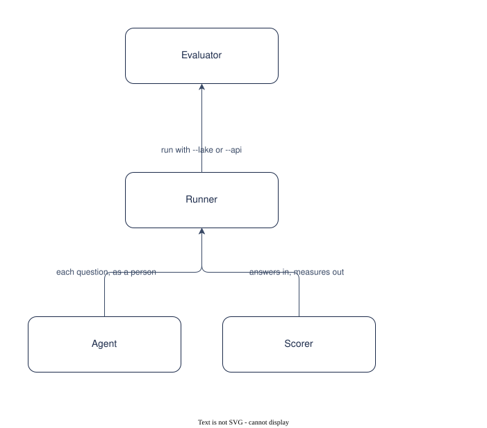

# UC-007 Evaluate the answers

<!-- deck:cover subtitle="Evaluate the answers" footnote="Use case, reversed from the implementation at 0.3.0. Draft." -->

| Field | Value |
|---|---|
| Use case | UC-007 |
| Consumer | An evaluator |
| Owner | Patternode (Dermot O'Brien) |
| Outcome | OC-001 |
| Rests on | The implementation as released; this use case is reversed from it |
| Realised by | AP-001 Ontology-driven GraphRAG (logical) and RA-001 Knowledge Store on AWS (physical) |
| Fulfilled by | FE-016 |
| Date | 2026-10-16 |

<!-- deck:slide label="In one sentence" -->

## The solution in one sentence

An evaluator runs a set of questions with the facts a right answer states and the documents it should cite against a lake or the deployed chat, and reads a deterministic score, so that a release or an ontology change can be judged against the last.

Grounded is not the same as right. Without a set and a scorer, a change to the prompt, the ontology or the model cannot be compared.

### What is different afterwards

A report with accuracy, mean score, grounded share, source hits, false abstentions and missed abstentions, overall and per question kind.

<!-- deck:slide label="On one page" title="The solution on one page" -->

## Diagram

Generated from the Participants and Interactions tables with the model skill; `components.drawio` is the source.

<!-- deck:slide label="Participants" -->

## Participants

| Participant | Role in this use case | Kind |
|---|---|---|
| 01 Evaluator | Writes the set, runs it, reads the report | actor |
| 02 Runner | In-process or against the API | solution |
| 03 Agent | Answers each question | solution |
| 04 Scorer | Deterministic measures and the report | solution |

<!-- deck:slide label="Interactions" -->

## Interactions

| Interface | Provider | Consumer | Purpose |
|---|---|---|---|
| IF-01 | 02 Runner | 01 Evaluator | run with --lake or --api |
| IF-02 | 03 Agent | 02 Runner | each question, as a person |
| IF-03 | 04 Scorer | 02 Runner | answers in, measures out |

<!-- deck:slide label="Catalogue mapping" -->

## Catalogue Mapping

What each local participant stands for in the catalogue: an actor or an external system is a gap by design (no artefact of this catalogue realises a person or a vendor); a solution participant realises or partly realises a building block.

| Local ID | Maps To | Relationship |
|---|---|---|
| 01 | gap | gap |
| 02 | ABB-021 Evaluation runner | realises |
| 03 | ABB-014 Answering agent | realises |
| 04 | ABB-021 Evaluation runner | partial |

## Scenarios

Step through the flows in the [animated walkthrough](./scenarios.html).

<!-- deck:html src="./scenarios.html" title="The flow" header="true" -->

### S1 Main success scenario

| Step | Actor | Target | Action | Interface |
|---|---|---|---|---|
| 1 | 01 Evaluator | 02 Runner | start a run; confirm the estimate | IF-01 |
| 2 | 02 Runner | 03 Agent | ask each question, polling the API or calling in process | IF-02 |
| 3 | 02 Runner | 04 Scorer | score must, must_not, first, sources and abstention | IF-03 |
| 4 | 04 Scorer | 01 Evaluator | write report.md and results.json | IF-03 |

<!-- deck:slide label="Data and measures" title="Data and measures" -->

## Data

- The set, the answers with claims_proposed and claims_shown, the report

## Measures

- OC-001-M2 false positives
- OC-001-M3 grounded share

## Preconditions and success

Preconditions: A set in the YAML format with valid kinds; Either a lake and model credentials, or a portal URL and a person's token.

Success: No model judges; a fact is found or not; An unanswerable question counts as right only when the agent abstained; The estimate is shown before money is spent.
