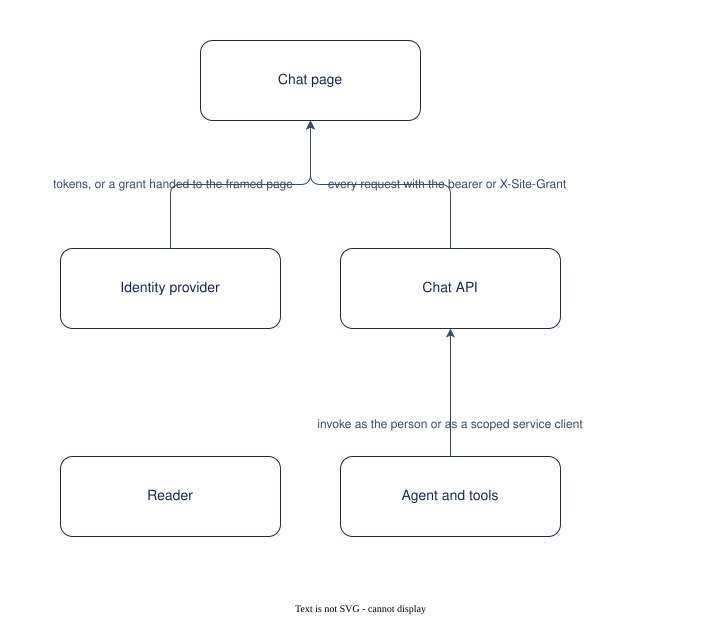

# UC-008 Sign in and read within scope

<!-- deck:cover subtitle="Sign in and read within scope" footnote="Use case, reversed from the implementation at 0.3.0. Draft." -->

| Field | Value |
|---|---|
| Use case | UC-008 |
| Consumer | A reader |
| Owner | Patternode (Dermot O'Brien) |
| Outcome | OC-003 |
| Rests on | The implementation as released; this use case is reversed from it |
| Realised by | PAT-001 Ontology-driven GraphRAG (logical) and REF-001 Knowledge Store on AWS (physical) |
| Fulfilled by | FE-012, FE-013, FE-024 |
| Date | 2026-10-16 |

<!-- deck:slide label="In one sentence" -->

## The solution in one sentence

A reader signs in, with the deployment's own sign-in or through the website that hosts the store, and sees only the content their scope allows, with the same identity checked at the page, the API, the agent and the tools, so that private sources never reach a public reader whatever a model asks for.

A chat that acts as a service sees everything and leaks by prompt. The person's own identity has to travel to the data.

### What is different afterwards

A person in the private-readers group, with a private role, or an application with the private scope reads private facts, passages, rows and documents; everyone else reads public ones, and the interceptor makes that true for every tool call.

<!-- deck:slide label="On one page" title="The solution on one page" -->

## Diagram

Generated from the Participants and Interactions tables with the model skill; `components.drawio` is the source.

<!-- deck:slide label="Participants" -->

## Participants

| Participant | Role in this use case | Kind |
|---|---|---|
| 01 Reader | Signs in and reads | actor |
| 02 Chat page | Code flow with PKCE, or the host's grant | solution |
| 03 Identity provider | Cognito, or the host website's keys | external |
| 04 Chat API | Verifies, reads sub and groups or roles, filters | solution |
| 05 Agent and tools | The same token; the interceptor sets the scope | solution |

<!-- deck:slide label="Interactions" -->

## Interactions

| Interface | Provider | Consumer | Purpose |
|---|---|---|---|
| IF-01 | 03 Identity provider | 02 Chat page | tokens, or a grant handed to the framed page |
| IF-02 | 04 Chat API | 02 Chat page | every request with the bearer or X-Site-Grant |
| IF-03 | 05 Agent and tools | 04 Chat API | invoke as the person or as a scoped service client |

<!-- deck:slide label="Catalogue mapping" -->

## Catalogue Mapping

What each local participant stands for in the catalogue: an actor or an external system is a gap by design (no artefact of this catalogue realises a person or a vendor); a solution participant realises or partly realises a building block.

| Local ID | Maps To | Relationship |
|---|---|---|
| 01 | gap | gap |
| 02 | ABB-018 Chat page | realises |
| 03 | gap | gap |
| 04 | ABB-019 Chat API | partial |
| 05 | ABB-020 Identity and scope | partial |

## Scenarios

Step through the flows in the [animated walkthrough](./scenarios.html).

<!-- deck:html src="./scenarios.html" title="The flow" header="true" -->

### S1 Main success scenario, hosted sign-in

| Step | Actor | Target | Action | Interface |
|---|---|---|---|---|
| 1 | 01 Reader | 02 Chat page | sign in through the hosted UI with PKCE | IF-01 |
| 2 | 02 Chat page | 04 Chat API | send the access token on every request | IF-02 |
| 3 | 04 Chat API | 05 Agent and tools | pass the same token; the Runtime and the Gateway verify it; the interceptor writes caller_private | IF-03 |
| 4 | 04 Chat API | 01 Reader | show only what the scope allows; sign a document link after the check | IF-02 |

### S2 Sign-in through a host website

| Step | Actor | Target | Action | Interface |
|---|---|---|---|---|
| 1 | 03 Identity provider | 02 Chat page | the website frames the page and hands it a short ES256 grant | IF-01 |
| 2 | 02 Chat page | 04 Chat API | send X-Site-Grant; the API verifies signature, issuer, audience, expiry and roles | IF-02 |
| 3 | 04 Chat API | 05 Agent and tools | ask the agent as the public or the private service client | IF-03 |

<!-- deck:slide label="Data and measures" title="Data and measures" -->

## Data

- Token claims: sub, groups, scope; grant claims: sub, roles
- Scope per source, per table

## Measures

- Scope leaks found by the test suite, zero
- Requests refused at the origin check

## Preconditions and success

Preconditions: An administrator created the user, or the host website signs them in and holds a key the deployment trusts.

Success: A public caller never sees a private entity, passage, relation, table or document link; The interceptor overwrites the scope argument on every call; A link to a document or a table is signed only after the scope check, for ten minutes.
