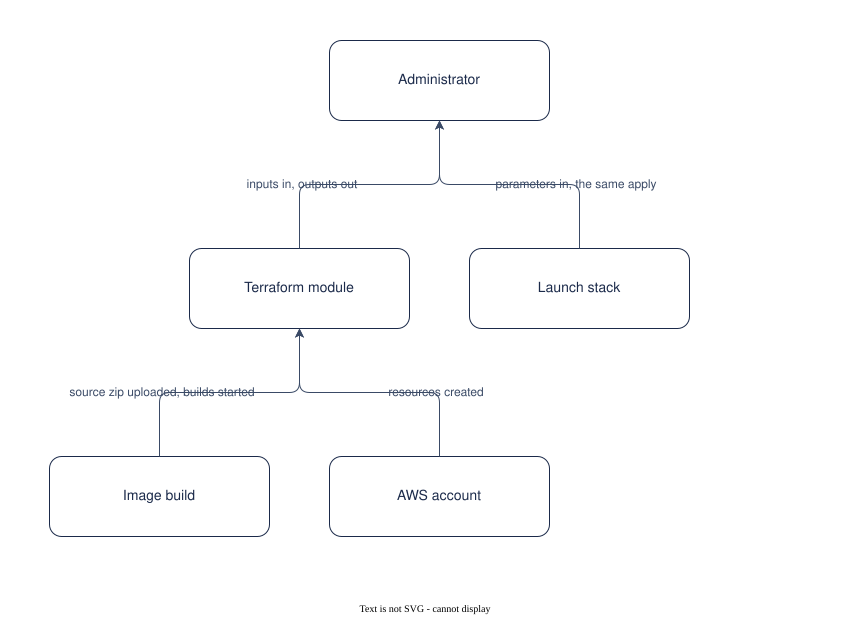

# UC-009 Deploy the store in your own account

<!-- deck:cover subtitle="Deploy the store in your own account" footnote="Use case, reversed from the implementation at 0.3.0. Draft." -->

| Field | Value |
|---|---|
| Use case | UC-009 |
| Consumer | An administrator |
| Owner | Patternode (Dermot O'Brien) |
| Outcome | OC-003 |
| Rests on | The implementation as released; this use case is reversed from it |
| Realised by | AP-001 Ontology-driven GraphRAG (logical) and RA-001 Knowledge Store on AWS (physical) |
| Fulfilled by | FE-017, FE-018, FE-019, FE-021 |
| Date | 2026-10-16 |

<!-- deck:slide label="In one sentence" -->

## The solution in one sentence

An administrator applies one Terraform module, or launches one CloudFormation stack, into their own AWS account with their collections, models, network and valves, and has a working store after a second apply switches the agent on, so that nothing is run or hosted anywhere else.

A reference architecture that takes a platform team to stand up is not adopted. The deployment has to be one module with sane defaults, buildable from inside the account, and upgradable by moving a tag.

### What is different afterwards

A portal URL, an upload location per collection, the pipeline logs and the evaluate command; images built in the account; a tag to move for the next release.

<!-- deck:slide label="On one page" title="The solution on one page" -->

## Diagram

Generated from the Participants and Interactions tables with the model skill; `components.drawio` is the source.

<!-- deck:slide label="Participants" -->

## Participants

| Participant | Role in this use case | Kind |
|---|---|---|
| 01 Administrator | Configures, applies, upgrades | actor |
| 02 Terraform module | Nine submodules under one | solution |
| 03 Image build | CodeBuild from the uploaded source | solution |
| 04 Launch stack | CloudFormation running the same Terraform | solution |
| 05 AWS account | Where everything lands | external |

<!-- deck:slide label="Interactions" -->

## Interactions

| Interface | Provider | Consumer | Purpose |
|---|---|---|---|
| IF-01 | 02 Terraform module | 01 Administrator | inputs in, outputs out |
| IF-02 | 03 Image build | 02 Terraform module | source zip uploaded, builds started |
| IF-03 | 05 AWS account | 02 Terraform module | resources created |
| IF-04 | 04 Launch stack | 01 Administrator | parameters in, the same apply |

<!-- deck:slide label="Catalogue mapping" -->

## Catalogue Mapping

What each local participant stands for in the catalogue: an actor or an external system is a gap by design (no artefact of this catalogue realises a person or a vendor); a solution participant realises or partly realises a building block.

| Local ID | Maps To | Relationship |
|---|---|---|
| 01 | gap | gap |
| 02 | gap | gap |
| 03 | gap | gap |
| 04 | gap | gap |
| 05 | gap | gap |

## Scenarios

Step through the flows in the [animated walkthrough](./scenarios.html).

<!-- deck:html src="./scenarios.html" title="The flow" header="true" -->

### S1 Main success scenario

| Step | Actor | Target | Action | Interface |
|---|---|---|---|---|
| 1 | 01 Administrator | 02 Terraform module | set admin_email, name, collections, models, network, valves; init, plan, apply | IF-01 |
| 2 | 02 Terraform module | 05 AWS account | create the lake, network, pipeline, graph, knowledge base, identity, portal, gateway and tools | IF-03 |
| 3 | 02 Terraform module | 03 Image build | upload the source; the rule starts both builds | IF-02 |
| 4 | 01 Administrator | 02 Terraform module | set agent.runtime true; apply again | IF-01 |
| 5 | 02 Terraform module | 01 Administrator | output the portal URL, upload locations, logs and the evaluate command | IF-01 |

### S2 Upgrade

| Step | Actor | Target | Action | Interface |
|---|---|---|---|---|
| 1 | 01 Administrator | 02 Terraform module | move ref to the new tag, read the release notes, plan and apply | IF-01 |

### S3 Without Terraform

| Step | Actor | Target | Action | Interface |
|---|---|---|---|---|
| 1 | 01 Administrator | 04 Launch stack | launch the CloudFormation stack with its parameters | IF-04 |
| 2 | 04 Launch stack | 02 Terraform module | run the same apply in a CodeBuild project | IF-04 |

<!-- deck:slide label="Data and measures" title="Data and measures" -->

## Data

- The module inputs and outputs (CT-010)
- The release tag

## Measures

- OC-003-M1 idle cost
- Applies to a working chat, two

## Preconditions and success

Preconditions: An AWS account with Bedrock model access granted and service quotas checked; Terraform and a state bucket, or the launch stack.

Success: The first apply creates everything but the agent Runtime; the second switches it on after the image is built; Nothing is pulled from outside the account but the pinned base image; Destroying removes it, keeping the lake unless told otherwise.
