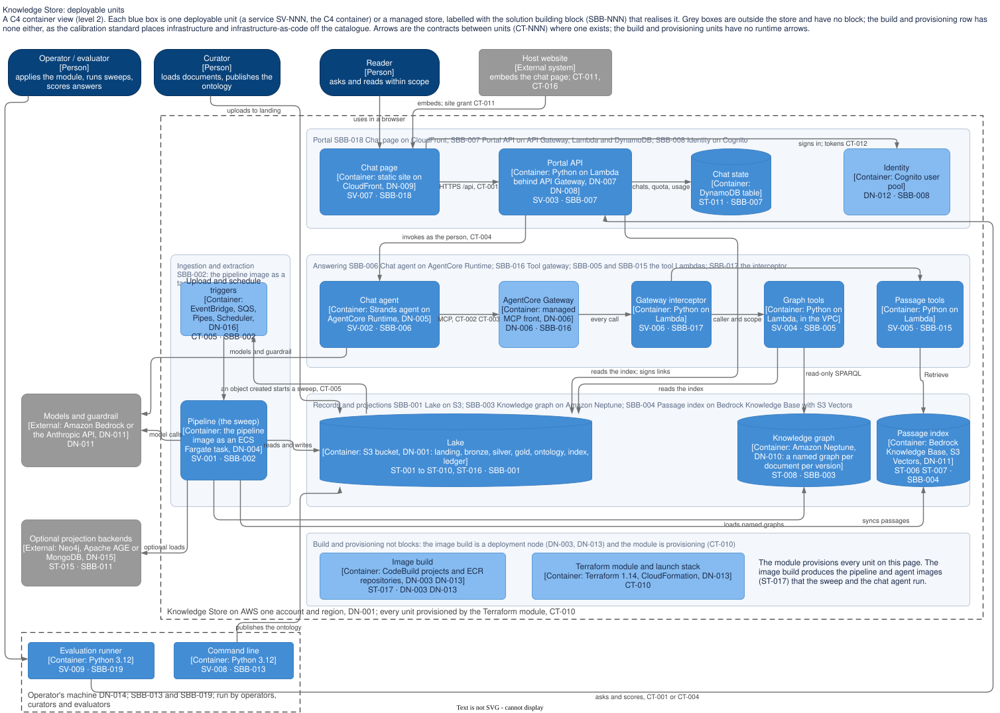

# Deployable units: a C4 container view

The diagram is C4 level 2, the container view. Every blue box is one deployable unit: a service from [services.csv](services.csv), the C4 container, or a managed store from [stores.csv](stores.csv), and each is labelled with the solution building block in [solution/sbbs.csv](../solution/sbbs.csv) that realises it. Grey boxes are outside the store. The arrows are the contracts in [solution/contracts.csv](../solution/contracts.csv) where one exists. The source is `deployable-units.drawio` beside it, exported by hand.

## How the C4 levels sit on the continuum

| C4 level | On the continuum | Here |
|---|---|---|
| 1 System context | The platform and the landscape: the system as one box, with the people and the systems around it | [platform.md](../platform.md) and [landscape.md](../landscape.md) |
| 2 Container | The service, the deployable unit, with the stores it reads and writes and the nodes it runs on; its SBB says what it is built from | This page, [services.csv](services.csv), [nodes.csv](nodes.csv) |
| 3 Component | The building blocks inside a service: the ABBs a service composes and the SBB's parts | The ABB and SBB pages, and the patterns PAT-001 and REF-001 |
| 4 Code | The modules in the repository | `module_path` and `packages` on each service page |

## Reading the diagram

| Unit | SBB | What it is |
|---|---|---|
| SV-007 Chat page | SBB-007 | The static site on CloudFront, embedded by a host website under the site grant (CT-011, CT-016) |
| SV-003 Portal API | SBB-007 | The Lambda behind API Gateway: CT-001, the quota, chat state in DynamoDB (ST-011), signed links into the lake |
| DN-012 Identity | SBB-008 | The Cognito user pool: sign-in, tokens, groups and scopes (CT-012) |
| SV-002 Chat agent | SBB-006 | The Strands agent on AgentCore Runtime, invoked as the person (CT-004), calling tools over MCP (CT-002, CT-003) and models through SBB-012 |
| SV-006, SV-004, SV-005 | SBB-005 | The Gateway interceptor on every call, then the graph tools (read-only SPARQL on Neptune, the gold index) and the passage tools (Retrieve on the passage index) |
| ST-001 to ST-010, ST-016 Lake | SBB-001 | The S3 bucket with every layer: landing, bronze, silver, gold, ontology, index and ledger; an object created in landing starts a sweep (CT-005) |
| ST-008 Knowledge graph | SBB-003 | Amazon Neptune, one named graph per document per version, loaded by the sweep |
| ST-006, ST-007 Passage index | SBB-004 | The Bedrock Knowledge Base with S3 Vectors, synced per passage by the sweep |
| SV-001 Pipeline | SBB-014 on SBB-002 | The pipeline image as an ECS Fargate task, started by the triggers (EventBridge, SQS, Pipes, Scheduler) |
| ST-017 Image build | SBB-009 | CodeBuild and ECR, producing the pipeline and agent images |
| CT-010 Terraform module | SBB-010 | The module with the CloudFormation launch stack, provisioning every unit above |
| SV-008, SV-009 | SBB-013 | The command line and the evaluation runner on an operator's machine, the local profile |
| Optional projection backends | SBB-011 | Neo4j, Apache AGE or MongoDB (ST-015), loaded by the sweep when configured |
| Models and guardrail | SBB-012 | Amazon Bedrock or the Anthropic API, called by the sweep and the agent |

Two findings are visible here. SV-001 and SV-003 each compose several bounded contexts (CN-006), so the pipeline image and the portal Lambda are larger units than the continuum's one service per context. And the Portal API still carries a fallback tool loop of its own until the Runtime exists, which is why it reaches the lake directly.
