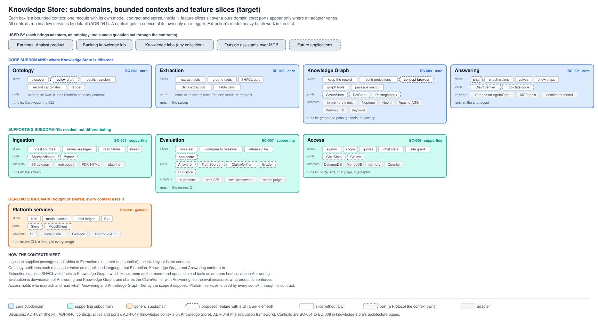

# Bounded contexts

Where one model and one language hold. Eight contexts inside PL-001, each with its ubiquitous language, the modules that hold its model today, and its relationships with the others in strategic DDD terms. The register is [../contexts.csv](../contexts.csv).

## Context map

Each context is a package of its own in `src/knowledge_store/`, organised as patternode-architecture ADR-046 sets out: a pure domain, feature slices over it, ports only where an adapter varies, adapters at the edge, and one contract (the package's `__init__`) that other contexts import. The deployables compose contexts: the pipeline image runs BC-001 to BC-004 through the sweep, and the agent image runs BC-005 with BC-004's tools. Each deployable's composition root lives in `apps/`, and a context gets a deployable of its own only on an ADR-044 trigger (CN-006). The services register ([../../runtime/services.csv](../../runtime/services.csv)) says what each deployable composes.

| Context | Package | Contract | Composition roots that use it |
|---|---|---|---|
| BC-001 Ingestion | `ingestion` | `ingest_source`, `bronze_objects`, `load_doc`, `load_passages`, `silver_doc_ids`, `Passage` | `apps/sweep.py`, `apps/cli.py` |
| BC-002 Ontology | `ontology` | the model, renditions, versions, tool schema and mappings | the sweep, the CLI |
| BC-003 Extraction | `extraction` | table bindings, `mapped_doc_ids`, `data_base` | the sweep, the CLI |
| BC-004 Knowledge graph | `knowledge_graph` | `ReadModel`, `GraphStore`, `SparqlStore`, `PassageSearch`, the read tools, `index` | the sweep, `apps/portal_api.py`, the tools Lambda |
| BC-005 Answering | `answering` | `ClaimVerifier`, `QuestionScreen`, `answer_locally`, `run`, `Guardrail`, `workbench`, `valves` | `apps/agent.py`, `apps/portal_api.py` |
| BC-006 Access | `access` | `agent_quota` (claims, state and the interceptor are used by their deployables directly) | `apps/agent.py`, `apps/portal_api.py`, the interceptor Lambda |
| BC-007 Evaluation | `evaluation` | the set model, scoring, `run`, `gate`, the adapters | `apps/evaluate.py` |
| BC-008 Platform services | `platform_services` | `Store`, `ModelClient`, `layout`, `llm`, `ledger`, collections and configuration | every deployable |

The boundaries are checked on every test run: import-linter holds the layers inside each context and the contracts between them, and `tests/test_architecture.py` holds the rest (where configuration is read, no cycle between contexts, every published name resolves, the Lambdas import with the standard library and boto3 alone).

| Context | Subdomain | Realises | Contains |
|---|---|---|---|
| [BC-001 Ingestion](BC-001-ingestion/index.md) | supporting | CAP-002 | ABB-002, ABB-024 |
| [BC-002 Ontology](BC-002-ontology/index.md) | core | CAP-003, CAP-007 | ABB-024 |
| [BC-003 Extraction](BC-003-extraction/index.md) | core | CAP-004, CAP-007 | ABB-024 |
| [BC-004 Knowledge graph](BC-004-knowledge-graph/index.md) | core | CAP-005, CAP-006, CAP-007 | ABB-011, ABB-013, ABB-012, ABB-025, ABB-026 |
| [BC-005 Answering](BC-005-answering/index.md) | core | CAP-008, CAP-010, CAP-012 | ABB-014 |
| [BC-006 Portal and identity](BC-006-portal-and-identity/index.md) | supporting | CAP-009, CAP-010 | ABB-018, ABB-019, ABB-020, ABB-027 |
| [BC-007 Evaluation](BC-007-evaluation/index.md) | supporting | CAP-011 | ABB-021 |
| [BC-008 Platform services](BC-008-platform-services/index.md) | generic | CAP-010, CAP-013 | ABB-028 |
