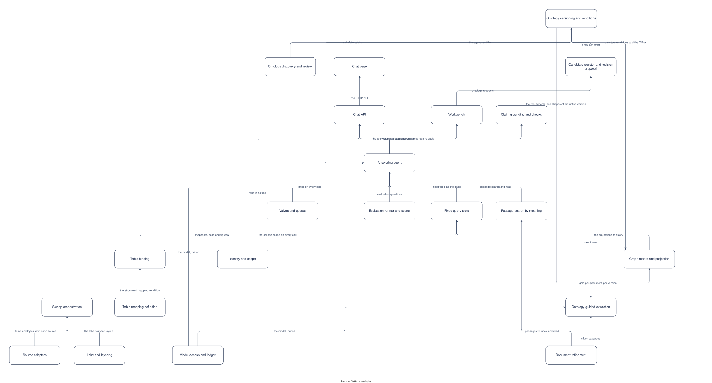

# PAT-001 Ontology-driven GraphRAG with grounded answers

<!-- deck:cover subtitle="The logical pattern: ontology, extraction with provenance, the graph as record, grounded answering" footnote="Reversed from the implementation at 0.3.0. Draft." -->

The logical pattern: technology-agnostic, in architecture building blocks. REF-001 is its physical form on AWS. Every use case in [../../demand/use-cases](../../../demand/use-cases/README.md) is realised by this pattern, and its scenarios walk theirs across the blocks named here; in UML terms this document is the use-case realization and the pattern it applies, in one.

<!-- deck:slide label="Context" -->

## Context

An organisation has documents and wants to answer questions from them with every statement checkable. Retrieval over chunks answers fluently and unverifiably; a graph answers precisely but only in the terms someone defined. The pattern joins the two under an ontology a person owns: documents become passages, passages become typed facts that cite them, the facts are the record, projections serve queries, and an agent answers through fixed tools with claims that code checks before anything is shown.

The audience is a team building a knowledge store over its own documents, in any domain, who will own the ontology.

<!-- deck:slide label="Non-goals" -->

### Non-goals

- A general chat assistant: the agent answers from the collection or abstains.
- A model as judge of truth: every check is code, with the guardrail as a second, bounded opinion.
- Free querying by the model: the tools are fixed.
- A document management system: sources are read, never managed.

<!-- deck:slide label="Quality attributes" -->

### Quality attributes

| Quality attribute | Scenario | Response measure |
|---|---|---|
| Groundedness | A model proposes a claim whose quote is not in the passage | The claim is repaired once or removed; it never reaches the page |
| Scope safety | A public caller's model asks a tool for private content | The interceptor sets the scope; the tool returns public content only |
| Cost | A question runs away in tool calls | The hook cancels the seventeenth call; the agent answers from what it has |
| Rebuildability | A projection is lost | The next sweep rebuilds it from gold; the pointer moves when counts check |
| Governance | A term is proposed from a document | It stays a candidate until a person publishes a version containing it |

<!-- deck:slide label="Component view" -->

## Diagram

Generated from the Required Building Blocks and Interfaces tables with the model skill (`components.drawio` is the source); the as-built picture is REF-001's.

<!-- deck:slide label="Building blocks" -->

## Required Building Blocks

| Building Block | Role in the pattern |
|---|---|
| ABB-002 Lake | The record and its layers; the contract every container reads |
| ABB-024 Ingestion and extraction pipeline | Bytes to published facts in one idempotent sweep; composes four contexts today |
| ABB-011 Knowledge graph | The graph projection, rebuilt from the record |
| ABB-013 Passage index | Passages by meaning; the hit is a passage id |
| ABB-012 Graph tools | Fixed, read-only tools in the ontology's terms, scope-filtered |
| ABB-025 Passage tools | Search and read of passages, scope-filtered |
| ABB-026 Tool gateway | One MCP surface and one token over the tools |
| ABB-027 Call interceptor | The one scope decision, before any tool runs |
| ABB-014 Answering agent | Plans, proposes, checks, repairs; nothing shown unchecked |
| ABB-019 Chat API | The narrow door; quota, state, signed links |
| ABB-018 Chat page | Where grounding is visible |
| ABB-020 Identity | The person all the way down |
| ABB-028 Command line | The whole store on one machine; the release commands |
| ABB-021 Evaluation runner | Right, not only grounded |

Every box is one C4 container under the [calibration standard](https://github.com/dermot-obrien/architecture-continuum/blob/main/standards/building-blocks/standard-building-block-calibration.md): the first pass's components (adapters, refinement, discovery, versioning, candidates, mapping, extraction, binding, projection, the checks, the valves, the workbench, the model client) are rows inside these blocks, and the deployment's infrastructure (triggers, build, module) is kept off the pattern.

<!-- deck:slide label="Interfaces" -->

## Interfaces

| Interface | Provider | Consumer | Purpose |
|---|---|---|---|
| IF-01 | ABB-002 Lake | ABB-024 Ingestion and extraction pipeline | the lake port, the layout and the upload events |
| IF-02 | ABB-024 Ingestion and extraction pipeline | ABB-011 Knowledge graph | named graphs loaded per document per version |
| IF-03 | ABB-024 Ingestion and extraction pipeline | ABB-013 Passage index | passages synced; an ingestion job |
| IF-04 | ABB-002 Lake | ABB-012 Graph tools | the gold index, the snapshots and the active version |
| IF-05 | ABB-011 Knowledge graph | ABB-012 Graph tools | read-only SPARQL |
| IF-06 | ABB-013 Passage index | ABB-025 Passage tools | Retrieve |
| IF-07 | ABB-002 Lake | ABB-025 Passage tools | passages read by id |
| IF-08 | ABB-012 Graph tools | ABB-026 Tool gateway | the graph toolset as a target |
| IF-09 | ABB-025 Passage tools | ABB-026 Tool gateway | the passages toolset as a target |
| IF-10 | ABB-027 Call interceptor | ABB-026 Tool gateway | the caller's scope on every call |
| IF-11 | ABB-026 Tool gateway | ABB-014 Answering agent | fixed tools over MCP as the caller |
| IF-12 | ABB-020 Identity | ABB-026 Tool gateway | token verification |
| IF-13 | ABB-020 Identity | ABB-019 Chat API | who is asking |
| IF-14 | ABB-020 Identity | ABB-018 Chat page | sign-in and tokens |
| IF-15 | ABB-020 Identity | ABB-014 Answering agent | tokens accepted |
| IF-16 | ABB-014 Answering agent | ABB-019 Chat API | the answer, steps streamed |
| IF-17 | ABB-019 Chat API | ABB-018 Chat page | the HTTP API |
| IF-18 | ABB-002 Lake | ABB-019 Chat API | served layers read; requests written; signed links |
| IF-19 | ABB-002 Lake | ABB-014 Answering agent | the agent rendition of the active version |
| IF-20 | ABB-002 Lake | ABB-028 Command line | the lake, over a folder or the bucket |
| IF-21 | ABB-028 Command line | ABB-002 Lake | a version published, activated or proposed |
| IF-22 | ABB-021 Evaluation runner | ABB-014 Answering agent | evaluation questions |
| IF-23 | ABB-021 Evaluation runner | ABB-019 Chat API | questions through the API as a person |

## Scenarios

The scenarios are the use cases': UC-001 S1 to S3 for answering, UC-002 for the sweep, UC-003 to UC-005 for the ontology lifecycle, UC-006 for tables, UC-007 for evaluation, UC-008 for scope. Each step of each is a call across one of the interfaces above.

<!-- deck:slide label="Controls" -->

## Controls

| Control | Where | What it stops |
|---|---|---|
| The scope rule at every hop | ABB-020 | A public caller reading private content |
| Claims checked by code | ABB-014 | An invented quote, value or figure |
| Fixed tools | ABB-012 | Writes, free queries, escape from scope |
| Valves | ABB-014 | Runaway cost per question, per person, per deployment |
| Publish refuses an understated bump | ABB-024 | A silent semantic change |
| Candidates stay out of the graph | ABB-024 | Document text changing the ontology |
| Documents as data | ABB-024 | Document text being executed or trusted |

<!-- deck:slide label="Decisions" -->

## Decisions

ADR-001 to ADR-005 and ADR-010 are this pattern's; ADR-006 to ADR-009 belong to REF-001.
