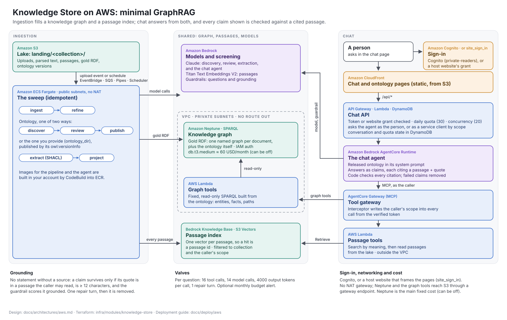

# REF-001 Knowledge Store on AWS

The physical pattern: PAT-001 made concrete in solution building blocks on AWS, as the module deploys it. The narrative, the request flow, the grounding table, the valves and the cost table are in [aws/aws.md](../../../aws/aws.md), which this page does not repeat; the components and their Terraform are in [the deployment components guide](../../../../deploy/aws/components.md). This page is the pattern's register form: what blocks, what interfaces, what controls, what decisions, so the catalogue can be walked from a use case to a running unit.

The source is [aws/architecture.drawio](../../../aws/architecture.drawio), generated by [aws/architecture.py](../../../aws/architecture.py).

## Context

One AWS account, one Terraform module, two applies. Ingestion as a Fargate sweep started by uploads; the record in S3; the graph in Neptune; the passage index on S3 Vectors; the tools behind AgentCore Gateway; the agent on AgentCore Runtime with Bedrock models and Guardrails; the page and API on CloudFront, API Gateway, Lambda and DynamoDB; sign-in with Cognito or a host website; images built in the account.

### Non-goals

Multi-region, multi-account and a shared tenant model are out of scope: one deployment is one account and one stack.

## Required Building Blocks

| Building Block | Realises | Role |
|---|---|---|
| SBB-001 Lake on S3 | ABB-002 | The record |
| SBB-002 Sweep on ECS Fargate with EventBridge, SQS, Pipes and Scheduler | ABB-004 | The sweep and its triggers |
| SBB-014 The pipeline image | ABB-001, ABB-003, ABB-005 to ABB-011 | Every pipeline-side block |
| SBB-003 Knowledge graph on Amazon Neptune | ABB-011 | The SPARQL projection |
| SBB-004 Passage index on Bedrock Knowledge Base with S3 Vectors | ABB-013 | Search by meaning |
| SBB-005 Tools on AgentCore Gateway with Lambda targets and the interceptor | ABB-012, ABB-013, ABB-020 | The fixed tools, scoped |
| SBB-006 Chat agent on AgentCore Runtime with Strands, Bedrock and Guardrails | ABB-014 to ABB-017 | Answering |
| SBB-007 Portal on CloudFront, API Gateway, Lambda and DynamoDB | ABB-018, ABB-019 | The page and the API |
| SBB-008 Identity on Cognito | ABB-020 | People and tokens |
| SBB-009 Image build on CodeBuild and ECR | ABB-023 | Images in the account |
| SBB-010 Terraform module with the CloudFormation launch stack | ABB-023 | The deployment |
| SBB-012 Model access through Bedrock or the Anthropic API | ABB-022 | The model, priced |
| SBB-011 Optional projection backends | ABB-011 | When memory is outgrown |

## Interfaces

The contracts register, [../../contracts.csv](../../contracts.csv), is this pattern's interface table: CT-001 the HTTP API, CT-002 and CT-003 the tools, CT-004 the invocation, CT-005 the events, CT-006 the renditions, CT-010 the module, CT-011 and CT-012 identity, CT-015 the lake layout, CT-016 the page's configuration.

## Deployment view

| Service | Node | Store |
|---|---|---|
| SV-001 pipeline | DN-004 Fargate in DN-002 | writes ST-002 to ST-006, ST-008, ST-009, ST-010, ST-015, ST-016 |
| SV-002 chat-agent | DN-005 AgentCore Runtime | ST-011 agent# keys |
| SV-003 portal-api | DN-007 Lambda behind DN-008 and DN-009 | ST-011; reads ST-004, ST-005, ST-003, ST-002 |
| SV-004 tools-graph | DN-007 Lambda in DN-002 behind DN-006 | reads ST-008, ST-004, ST-005 |
| SV-005 tools-passages | DN-007 Lambda behind DN-006 | reads ST-007, ST-003, ST-004 |
| SV-006 agent-interceptor | DN-007 Lambda on DN-006 | none |
| SV-007 chat-page | DN-009 CloudFront from ST-012 | browser storage |

## Controls

Those of PAT-001, plus: the origin secret between CloudFront and the API; reserved concurrency and the API throttle; the web ACL input; IAM authentication and private subnets for Neptune; a role per unit with a permissions boundary; the budget alert; images pinned by digest. The full table is [security.md](../../../security.md).

## Cost

The cost table in [aws/aws.md](../../../aws/aws.md#costs) is the cost model: the Neptune instance is the fixed cost; everything else is per use; model calls are the cost that matters.

## Decisions

ADR-006 one module built in-account; ADR-007 the passage index on S3 Vectors; ADR-008 memory by default with optional backends; ADR-009 tables bound as snapshots. Open: CN-001 the graph at scale, CN-006 the deployables along the contexts.
