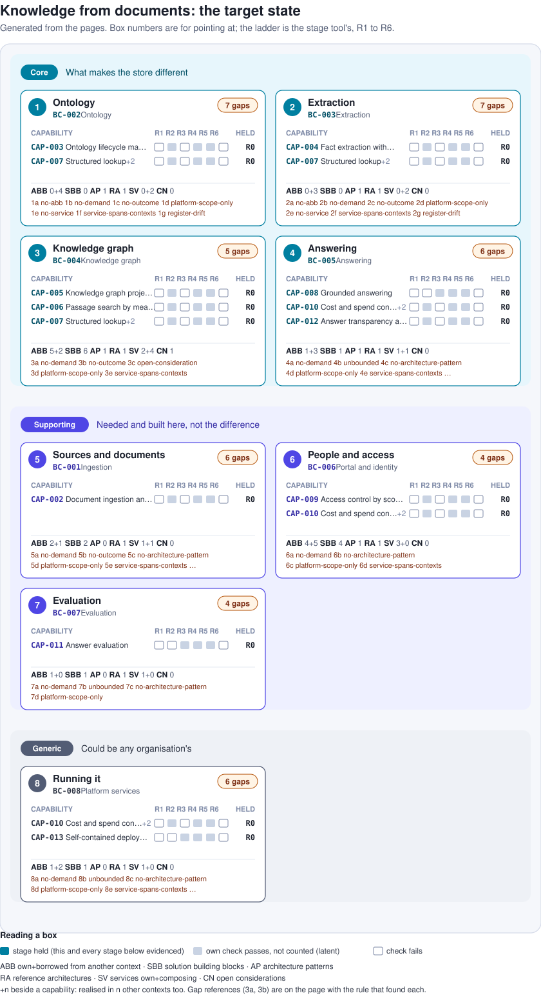
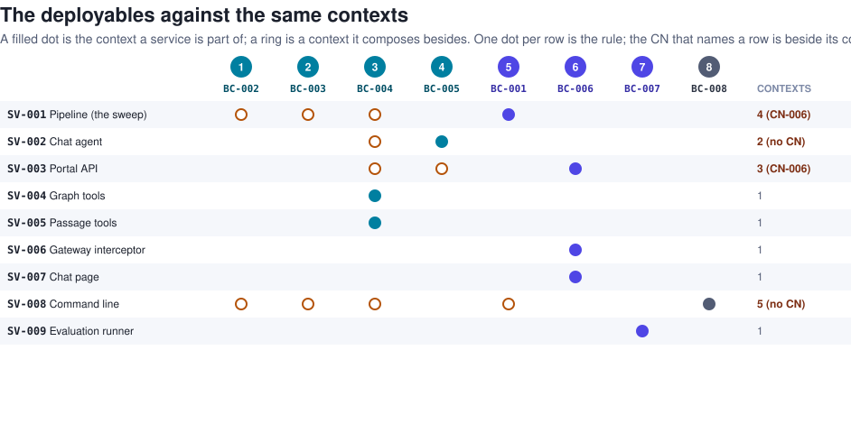

<!-- Generated by scripts/target-state.mjs from the architecture pages and the aaa-rung skill's stages. Do not edit; regenerate. -->

# Target state by subdomain

The target state of knowledge from documents is every subdomain on the [domain page](demand/domains.md) solved: each mapped through its bounded context to capabilities, building blocks, patterns and services, and each capability at the stage the [definition ladder](https://github.com/dermot-obrien/architecture-continuum/blob/main/standards/capabilities/standard-definition-ladder.md) calls buildable or beyond. This page is generated from the pages by `node scripts/target-state.mjs`; the reasoning behind it is the design note [Target-state view by subdomain](../design/target-state-view.md). The numbers are for pointing at in a session: a box is its subdomain's number, a gap is the box number and a letter, a pattern to elaborate is P and a number.

## The numbered map

| Box | Subdomain | Kind | Context | Outcomes | Capabilities | Lowest stage | ABB own+borrowed | SBB | AP | RA | SV own+composing | Open CN | Gaps |
|---|---|---|---|---|---|---|---|---|---|---|---|---|---|
| 1 | Ontology | core | [BC-002](solution/contexts/BC-002-ontology/index.md) | OC-002 | CAP-003, CAP-007 | R0 | 0+4 | 0 | 1 | 1 | 0+2 | 0 | 7 |
| 2 | Extraction | core | [BC-003](solution/contexts/BC-003-extraction/index.md) | OC-001, OC-002 | CAP-004, CAP-007 | R0 | 0+3 | 0 | 1 | 1 | 0+2 | 0 | 7 |
| 3 | Knowledge graph | core | [BC-004](solution/contexts/BC-004-knowledge-graph/index.md) | OC-001 | CAP-005, CAP-006, CAP-007 | R0 | 5+2 | 6 | 1 | 1 | 2+4 | 1 | 5 |
| 4 | Answering | core | [BC-005](solution/contexts/BC-005-answering/index.md) | OC-001, OC-002, OC-003 | CAP-008, CAP-010, CAP-012 | R0 | 1+3 | 1 | 1 | 1 | 1+1 | 0 | 6 |
| 5 | Sources and documents | supporting | [BC-001](solution/contexts/BC-001-ingestion/index.md) |  | CAP-002 | R0 | 2+1 | 2 | 0 | 1 | 1+1 | 0 | 6 |
| 6 | People and access | supporting | [BC-006](solution/contexts/BC-006-portal-and-identity/index.md) | OC-003 | CAP-009, CAP-010 | R0 | 4+5 | 4 | 1 | 1 | 3+0 | 0 | 4 |
| 7 | Evaluation | supporting | [BC-007](solution/contexts/BC-007-evaluation/index.md) | OC-001 | CAP-011 | R0 | 1+0 | 1 | 0 | 1 | 1+0 | 0 | 4 |
| 8 | Running it | generic | [BC-008](solution/contexts/BC-008-platform-services/index.md) | OC-003 | CAP-010, CAP-013 | R0 | 1+2 | 1 | 0 | 1 | 1+0 | 0 | 6 |

The lowest stage is the lowest held by any of the box's capabilities, as the stage tool derives it; a capability realised in more than one context counts in each. Borrowed building blocks realise the box's capabilities but are part of another context.

## Stage by capability

Each capability's stage and the first thing blocking the next one, from `rung.py --json`. A stage whose own check passes above the stage held is latent: it will count once the stages below it hold.

| Box | Capability | Held | Passes its own check | Blocking the next stage |
|---|---|---|---|---|
| 1 | [CAP-003](demand/capabilities/CAP-003-ontology-lifecycle-management/index.md) Ontology lifecycle management | R0 | R2 R4 R5 | CAP-003 names no demand: add required_by_outcomes, or record demand_assumption |
| 1 | [CAP-007](demand/capabilities/CAP-007-structured-lookup/index.md) Structured lookup | R0 | R2 R4 R5 | CAP-007 names no demand: add required_by_outcomes, or record demand_assumption |
| 2 | [CAP-004](demand/capabilities/CAP-004-fact-extraction-with-provenance/index.md) Fact extraction with provenance | R0 | R2 R4 R5 | CAP-004 names no demand: add required_by_outcomes, or record demand_assumption |
| 2 | [CAP-007](demand/capabilities/CAP-007-structured-lookup/index.md) Structured lookup | R0 | R2 R4 R5 | CAP-007 names no demand: add required_by_outcomes, or record demand_assumption |
| 3 | [CAP-005](demand/capabilities/CAP-005-knowledge-graph-projection-and-query/index.md) Knowledge graph projection and query | R0 | R2 R4 R5 | CAP-005 names no demand: add required_by_outcomes, or record demand_assumption |
| 3 | [CAP-006](demand/capabilities/CAP-006-passage-search-by-meaning/index.md) Passage search by meaning | R0 | R2 R4 R5 | CAP-006 names no demand: add required_by_outcomes, or record demand_assumption |
| 3 | [CAP-007](demand/capabilities/CAP-007-structured-lookup/index.md) Structured lookup | R0 | R2 R4 R5 | CAP-007 names no demand: add required_by_outcomes, or record demand_assumption |
| 4 | [CAP-008](demand/capabilities/CAP-008-grounded-answering/index.md) Grounded answering | R0 | R3 R4 R5 | CAP-008 names no demand: add required_by_outcomes, or record demand_assumption |
| 4 | [CAP-010](demand/capabilities/CAP-010-cost-and-spend-control/index.md) Cost and spend control | R0 | R2 R4 R5 | CAP-010 names no demand: add required_by_outcomes, or record demand_assumption |
| 4 | [CAP-012](demand/capabilities/CAP-012-answer-transparency-and-curation-feedback/index.md) Answer transparency and curation feedback | R0 | R2 R4 R5 | CAP-012 names no demand: add required_by_outcomes, or record demand_assumption |
| 5 | [CAP-002](demand/capabilities/CAP-002-document-ingestion-and-passage-derivation/index.md) Document ingestion and passage derivation | R0 | R2 R4 R5 | CAP-002 names no demand: add required_by_outcomes, or record demand_assumption |
| 6 | [CAP-009](demand/capabilities/CAP-009-access-control-by-scope/index.md) Access control by scope | R0 | R2 R4 R5 | CAP-009 names no demand: add required_by_outcomes, or record demand_assumption |
| 6 | [CAP-010](demand/capabilities/CAP-010-cost-and-spend-control/index.md) Cost and spend control | R0 | R2 R4 R5 | CAP-010 names no demand: add required_by_outcomes, or record demand_assumption |
| 7 | [CAP-011](demand/capabilities/CAP-011-answer-evaluation/index.md) Answer evaluation | R0 | R3 R4 R5 | CAP-011 names no demand: add required_by_outcomes, or record demand_assumption |
| 8 | [CAP-010](demand/capabilities/CAP-010-cost-and-spend-control/index.md) Cost and spend control | R0 | R2 R4 R5 | CAP-010 names no demand: add required_by_outcomes, or record demand_assumption |
| 8 | [CAP-013](demand/capabilities/CAP-013-self-contained-deployment-and-operation/index.md) Self-contained deployment and operation | R0 | R3 R4 R5 | CAP-013 names no demand: add required_by_outcomes, or record demand_assumption |

## Gaps

| Ref | Rule | What is missing |
|---|---|---|
| 1a | no-abb | BC-002 contains no building block of its own; its model runs inside ABB-002 (BC-001), ABB-012 (BC-004), ABB-024 (BC-001), ABB-028 (BC-008) |
| 1b | no-demand | CAP-003, CAP-007 name no demand on the capability page, so the stage tool holds them at R0 (the outcomes name them, the inverse is not written) |
| 1c | no-outcome | CAP-007 is required by no outcome, so the demand it answers is not recorded anywhere |
| 1d | platform-scope-only | Only platform-scoped patterns (AP-001, RA-001) realise its capabilities; none is scoped to the subdomain |
| 1e | no-service | No deployable is BC-002's own; SV-001, SV-008 compose it |
| 1f | service-spans-contexts | SV-001 composes BC-001 BC-002 BC-003 BC-004 (no consideration names it); SV-008 composes BC-001 BC-002 BC-003 BC-004 BC-008 (no consideration names it) |
| 1g | register-drift | The use-case register still cites retired blocks of this context, which the pages no longer do: UC-003 ABB-006, UC-003 ABB-008, UC-004 ABB-005, UC-004 ABB-006, UC-005 ABB-007, UC-005 ABB-006, UC-006 ABB-008 |
| 2a | no-abb | BC-003 contains no building block of its own; its model runs inside ABB-012 (BC-004), ABB-024 (BC-001), ABB-028 (BC-008) |
| 2b | no-demand | CAP-004, CAP-007 name no demand on the capability page, so the stage tool holds them at R0 (the outcomes name them, the inverse is not written) |
| 2c | no-outcome | CAP-007 is required by no outcome, so the demand it answers is not recorded anywhere |
| 2d | platform-scope-only | Only platform-scoped patterns (AP-001, RA-001) realise its capabilities; none is scoped to the subdomain |
| 2e | no-service | No deployable is BC-003's own; SV-001, SV-008 compose it |
| 2f | service-spans-contexts | SV-001 composes BC-001 BC-002 BC-003 BC-004 (no consideration names it); SV-008 composes BC-001 BC-002 BC-003 BC-004 BC-008 (no consideration names it) |
| 2g | register-drift | The use-case register still cites retired blocks of this context, which the pages no longer do: UC-002 ABB-009, UC-005 ABB-009, UC-006 ABB-010 |
| 3a | no-demand | CAP-005, CAP-006, CAP-007 name no demand on the capability page, so the stage tool holds them at R0 (the outcomes name them, the inverse is not written) |
| 3b | no-outcome | CAP-006, CAP-007 are required by no outcome, so the demand they answer is not recorded anywhere |
| 3c | open-consideration | Open: CN-001 Neptune or Neo4j as the graph for an organisation's collections. R3 needs each resolved by an accepted decision |
| 3d | platform-scope-only | Only platform-scoped patterns (AP-001, RA-001) realise its capabilities; none is scoped to the subdomain |
| 3e | service-spans-contexts | SV-001 composes BC-001 BC-002 BC-003 BC-004 (no consideration names it); SV-002 composes BC-005 BC-004 (no consideration names it); SV-003 composes BC-006 BC-004 BC-005 (no consideration names it); SV-008 composes BC-001 BC-002 BC-003 BC-004 BC-008 (no consideration names it) |
| 4a | no-demand | CAP-008, CAP-010, CAP-012 name no demand on the capability page, so the stage tool holds them at R0 (the outcomes name them, the inverse is not written) |
| 4b | unbounded | CAP-008 fails R2: no consideration affects it or its ABBs, and it does not declare open_questions: none |
| 4c | no-architecture-pattern | CAP-010, CAP-012 are realised by no architecture pattern, only by the reference architecture |
| 4d | platform-scope-only | Only platform-scoped patterns (AP-001, RA-001) realise its capabilities; none is scoped to the subdomain |
| 4e | service-spans-contexts | SV-002 composes BC-005 BC-004 (no consideration names it); SV-003 composes BC-006 BC-004 BC-005 (no consideration names it) |
| 4f | register-drift | The use-case register still cites retired blocks of this context, which the pages no longer do: UC-001 ABB-015, UC-001 ABB-016, UC-001 ABB-017, UC-005 ABB-017, UC-006 ABB-015 |
| 5a | no-demand | CAP-002 names no demand on the capability page, so the stage tool holds it at R0 (the outcomes name them, the inverse is not written) |
| 5b | no-outcome | CAP-002 is required by no outcome, so the demand it answers is not recorded anywhere |
| 5c | no-architecture-pattern | CAP-002 is realised by no architecture pattern, only by the reference architecture |
| 5d | platform-scope-only | Only platform-scoped patterns (RA-001) realise its capabilities; none is scoped to the subdomain |
| 5e | service-spans-contexts | SV-001 composes BC-001 BC-002 BC-003 BC-004 (no consideration names it); SV-008 composes BC-001 BC-002 BC-003 BC-004 BC-008 (no consideration names it) |
| 5f | register-drift | The use-case register still cites retired blocks of this context, which the pages no longer do: UC-002 ABB-001, UC-002 ABB-003, UC-002 ABB-004, UC-003 ABB-004, UC-004 ABB-004 |
| 6a | no-demand | CAP-009, CAP-010 name no demand on the capability page, so the stage tool holds them at R0 (the outcomes name them, the inverse is not written) |
| 6b | no-architecture-pattern | CAP-010 is realised by no architecture pattern, only by the reference architecture |
| 6c | platform-scope-only | Only platform-scoped patterns (AP-001, RA-001) realise its capabilities; none is scoped to the subdomain |
| 6d | service-spans-contexts | SV-003 composes BC-006 BC-004 BC-005 (no consideration names it) |
| 7a | no-demand | CAP-011 names no demand on the capability page, so the stage tool holds it at R0 (the outcomes name them, the inverse is not written) |
| 7b | unbounded | CAP-011 fails R2: no consideration affects it or its ABBs, and it does not declare open_questions: none |
| 7c | no-architecture-pattern | CAP-011 is realised by no architecture pattern, only by the reference architecture |
| 7d | platform-scope-only | Only platform-scoped patterns (RA-001) realise its capabilities; none is scoped to the subdomain |
| 8a | no-demand | CAP-010, CAP-013 name no demand on the capability page, so the stage tool holds them at R0 (the outcomes name them, the inverse is not written) |
| 8b | unbounded | CAP-013 fails R2: no consideration affects it or its ABBs, and it does not declare open_questions: none |
| 8c | no-architecture-pattern | CAP-010, CAP-013 are realised by no architecture pattern, only by the reference architecture |
| 8d | platform-scope-only | Only platform-scoped patterns (RA-001) realise its capabilities; none is scoped to the subdomain |
| 8e | service-spans-contexts | SV-008 composes BC-001 BC-002 BC-003 BC-004 BC-008 (no consideration names it) |
| 8f | register-drift | The use-case register still cites retired blocks of this context, which the pages no longer do: UC-009 ABB-023, UC-009 ABB-022 |

## Patterns to elaborate next

Suggested from the gaps, core subdomains first, then by the number of gaps each would close. A suggestion is a starting point for the session, not a decision; the pattern skill writes the document.

| Ref | Kind | Scope | Box | Pattern | Realises | Why | Closes |
|---|---|---|---|---|---|---|---|
| P1 | architecture-pattern | domain | 1 | Ontology: the Ontology context as an architecture pattern | CAP-003, CAP-007 | names the context's own building blocks, which the catalogue lacks; scopes a logical pattern to the subdomain rather than the platform | 1a, 1d |
| P2 | architecture-pattern | domain | 2 | Extraction: the Extraction context as an architecture pattern | CAP-004, CAP-007 | names the context's own building blocks, which the catalogue lacks; scopes a logical pattern to the subdomain rather than the platform | 2a, 2d |
| P3 | architecture-pattern | domain | 3 | Knowledge graph: the Knowledge graph context as an architecture pattern | CAP-005, CAP-006, CAP-007 | scopes a logical pattern to the subdomain rather than the platform; is where CN-001 is argued in boxes | 3c, 3d |
| P4 | architecture-pattern | domain | 4 | Answering: the Answering context as an architecture pattern | CAP-008, CAP-010, CAP-012 | scopes a logical pattern to the subdomain rather than the platform | 4c, 4d |
| P5 | architecture-pattern | capability-area | 1+2+3 | Structured lookup across Ontology, Extraction, Knowledge graph | CAP-007 | the capability is realised in 3 contexts, and no pattern says how they divide it |  |
| P6 | architecture-pattern | capability-area | 4+6+8 | Cost and spend control across Answering, People and access, Running it | CAP-010 | the capability is realised in 3 contexts, and no pattern says how they divide it |  |
| P7 | architecture-pattern | domain | 5 | Sources and documents: the Ingestion context as an architecture pattern | CAP-002 | scopes a logical pattern to the subdomain rather than the platform | 5c, 5d |
| P8 | architecture-pattern | domain | 6 | People and access: the Portal and identity context as an architecture pattern | CAP-009, CAP-010 | scopes a logical pattern to the subdomain rather than the platform | 6b, 6c |
| P9 | architecture-pattern | domain | 7 | Evaluation: the Evaluation context as an architecture pattern | CAP-011 | scopes a logical pattern to the subdomain rather than the platform | 7c, 7d |
| P10 | architecture-pattern | domain | 8 | Running it: the Platform services context as an architecture pattern | CAP-010, CAP-013 | scopes a logical pattern to the subdomain rather than the platform | 8c, 8d |

No pattern in the catalogue carries a portfolio block yet, so none is shown as planned.

## The deployables against the same contexts

The view above is logical: subdomains and contexts, never the units that are deployed. The deployables are drawn from the same pages against the same numbered contexts, so the distance between the two is visible. This is the picture CN-006 asks about.

The editable form of both views is [target-state.drawio](./target-state.drawio), with the numbers and the gaps on their own layers, and the derived model is [target-state.json](./target-state.json).
